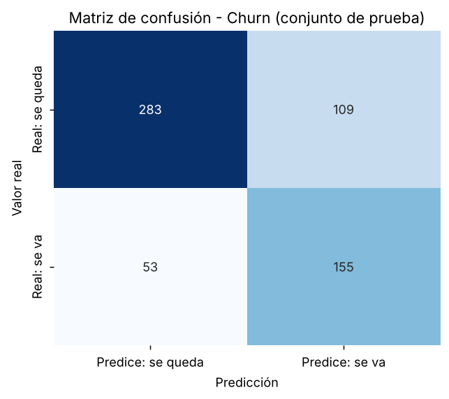

# Preentrega 10 - Modelado y evaluación de clasificación (Churn)

## 1. Descripción del problema
Una empresa de telecomunicaciones pierde clientes todos los meses (*churn*) y quiere **predecir cuáles van a darse de baja** para ofrecerles una acción de retención a tiempo.

Es un problema de **clasificación binaria**: la variable objetivo `churn` vale 1 si el cliente abandona y 0 si se queda. Se entrena una **Regresión Logística** con división **80% entrenamiento / 20% prueba** y se evalúa con Accuracy, Precision, Recall, F1 y matriz de confusión.

## 2. Contenido del repositorio
```
.
├── modelado_metricas.ipynb      # Notebook principal (carga, split 80/20, modelo, métricas, matriz, conclusión)
├── README.md                    # Este archivo
├── requirements.txt             # Librerías necesarias
├── .gitignore                   # Archivo .gitignore para Python
├── generar_dataset.py           # Script que crea los datos (opcional)
├── data/
│   └── clientes_churn.csv       # Dataset (3000 clientes, 7 variables + objetivo)
└── resultados/
    ├── metricas.csv             # Tabla de métricas generada por el notebook
    └── matriz_confusion.png     # Matriz de confusión generada por el notebook
```

## 3. Instrucciones de ejecución (paso a paso)
Requisito: tener **Python 3.9 o superior** instalado.

1. **Clonar el repositorio** y entrar a la carpeta:
   ```bash
   git clone https://github.com/<tu-usuario>/<nombre-del-repositorio>.git
   cd <nombre-del-repositorio>
   ```
2. **(Recomendado) crear un entorno virtual:**
   - Windows: `python -m venv .venv` y luego `.venv\Scripts\activate`
   - Mac/Linux: `python3 -m venv .venv` y luego `source .venv/bin/activate`
3. **Instalar las librerías:**
   ```bash
   pip install -r requirements.txt
   ```
4. **Abrir el notebook:**
   ```bash
   python -m notebook modelado_metricas.ipynb
   ```
5. En el menú del notebook elegir **Kernel -> Restart Kernel and Run All Cells**.
6. **Resultado esperado:** todas las celdas se ejecutan sin errores, se muestran la tabla de métricas y la matriz de confusión, y se actualizan los archivos de la carpeta `resultados/`.

> Si el archivo `data/clientes_churn.csv` no está, el notebook lo genera solo (semilla fija), así que siempre se puede ejecutar.

## 4. Resumen de resultados (conjunto de prueba, 20%)
| Métrica | Valor |
|---|---|
| Accuracy | 0.730 |
| Precision | 0.587 |
| **Recall** | **0.745** |
| F1-Score | 0.657 |

Matriz de confusión: verdaderos negativos = 283, falsos positivos = 109, **falsos negativos = 53**, verdaderos positivos = 155.



## 5. Conclusión de negocio
En un problema de Churn la métrica más importante es el **Recall**: un **falso negativo** (cliente que se va sin ser detectado) se pierde para siempre y conseguir un cliente nuevo cuesta mucho más que retener uno actual. Un **falso positivo** solo implica enviar una oferta de más. El modelo detecta el 75% de los clientes que abandonan, lo que permite dirigir las ofertas de retención a quienes tienen más riesgo. El Accuracy no alcanza como criterio porque las clases están desbalanceadas. El detalle completo está en la sección 7 del notebook.

## 6. Cumplimiento de la rúbrica
| Criterio | Dónde se verifica |
|---|---|
| Notebook ejecutable con división Train/Test | `modelado_metricas.ipynb`, secciones 1 y 2 |
| Al menos 4 métricas (Accuracy, Precision, Recall, F1) | Sección 4 del notebook y `resultados/metricas.csv` |
| Matriz de confusión con mapa de calor | Sección 5 del notebook y `resultados/matriz_confusion.png` |
| README con descripción e instrucciones | Este archivo (secciones 1 y 3) |
| Conclusión que vincula métricas con el negocio | Sección 7 del notebook y sección 5 de este archivo |

## 7. Sobre los datos
Dataset **simulado** con la estructura de un caso Telco Churn clásico: antigüedad, cargo mensual, cargos totales, tipo de contrato, servicio de internet, método de pago y soporte técnico. Se genera con semilla fija en `generar_dataset.py`, por lo que los resultados son reproducibles.
